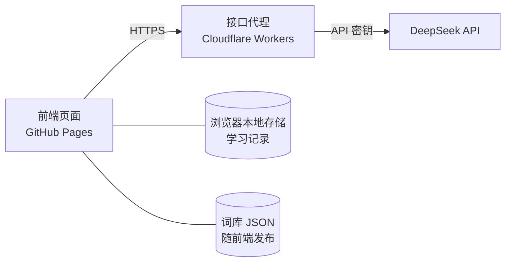

# AI 背单词应用 · 设计文档

作者：iteaisla

## 1. 概述

| 项目 | 说明 |
|---|---|
| 目标 | 按个人英语水平自动调整训练内容，并通过 AI 分析学习情况 |
| 用户 | 部门同事，英语水平不一，以手机使用为主 |
| 形式 | 网页应用，无需安装、无需注册 |
| 托管 | 前端：GitHub Pages；AI 接口代理：Cloudflare Workers（绑定自有域名） |
| 定位 | 培训演示项目，不用于正式生产 |
| AI 服务 | DeepSeek API，仅通过接口代理调用 |

## 2. 功能

| 功能 | 说明 | 版本 |
|---|---|---|
| 水平测试 | 按词频分段抽词测试，估算词汇量，确定起始难度 | V1 |
| 词库切换 | 大学英语四级、六级、雅思，进度独立保存 | V1 |
| 选择题练习 | 看词选义、看义选词，四选一 | V1 |
| 单词发音 | 调用浏览器语音合成 | V1 |
| 间隔复习 | 根据答题结果安排复习时间 | V1 |
| 难度调整 | 根据最近正确率升降难度等级 | V1 |
| 错词本 | 自动收录答错的单词 | V1 |
| AI 学习分析 | 分析答题统计，输出薄弱点和学习建议 | V2 |
| AI 个性化练习 | 为错词生成例句、中文释义和记忆提示 | V2 |
| 进度导出 / 导入 | 以文件形式备份学习记录 | V3 |

V1 不依赖 AI，可独立运行；V2 接入 AI。

## 3. 系统架构



| 层 | 职责 | 说明 |
|---|---|---|
| 前端 | 界面、出题、评分、复习调度、本地存储 | 纯 HTML + CSS + JavaScript，无构建步骤 |
| 接口代理 | 保存密钥、组装提示词、限流、跨域控制 | 前端不直接调用 AI，避免密钥暴露 |
| DeepSeek API | 学习分析、内容生成 | 兼容 OpenAI 接口格式；服务地址、密钥和模型名通过环境变量配置 |

**处理原则**：高频操作（出题、评分、复习）在本地完成；AI 仅用于低频、高价值的分析和生成，以控制成本和响应时间。

## 4. 数据设计

### 4.1 词库

由脚本 `scripts/build_words.py` 从 ECDICT 按考试标签（cet4、cet6、ielts）提取，每个词库一个文件，`data/index.json` 为词库列表。

- 仅保留纯字母单词，排除词形变化（复数、过去式等）和缩写。
- 各词库按词频排序后均分为 5 个难度等级。

| 词库 | 词数 |
|---|---|
| 大学英语四级 | 3692 |
| 大学英语六级 | 5211 |
| 雅思 | 4463 |

```json
{
  "id": "cet4",
  "name": "大学英语四级",
  "words": [
    { "w": "abandon", "p": "əˈbændən", "t": "v. 放弃；抛弃", "lv": 2 }
  ]
}
```

| 字段 | 说明 |
|---|---|
| `w` | 单词 |
| `p` | 音标 |
| `t` | 中文释义（精简至一至两个常用义项） |
| `lv` | 难度等级 1–5，按词频划分 |

### 4.2 学习记录（localStorage）

按词库分别存储，键名 `vocab:<词库 id>`。

```json
{
  "tested": true,
  "level": 3,
  "recent": [1, 0, 1, 1],
  "words": {
    "abandon": { "box": 2, "next": 1790899200000, "right": 3, "wrong": 1 }
  },
  "wrongBook": ["abandon"],
  "aiCache": { "abandon": { "sentence": "...", "translation": "...", "tip": "..." } },
  "aiReport": { "at": 1790899200000, "summary": "...", "weaknesses": [], "suggestions": [], "focusWords": [] }
}
```

| 字段 | 说明 |
|---|---|
| `level` | 当前难度等级 |
| `recent` | 最近 20 题结果，1 为正确 |
| `box` / `next` | 复习阶段、下次复习时间 |
| `aiCache` | AI 例句缓存，避免重复调用 |
| `aiReport` | 最近一次 AI 学习报告 |

## 5. 核心规则

### 5.1 水平测试

- 从难度 1–5 级各抽 6 词，共 30 题。
- 某级正确率不低于 70% 视为掌握，起始难度取未掌握的最低一级。

### 5.2 间隔复习

| 复习阶段（box） | 0 | 1 | 2 | 3 | 4 | 5 |
|---|---|---|---|---|---|---|
| 间隔 | 10 分钟 | 1 天 | 3 天 | 7 天 | 15 天 | 30 天 |

- 新词首次答对进入阶段 1；已学词答对进入下一阶段。
- 答错：回到阶段 0，并加入错词本。
- 错词本中的单词进入阶段 3（连续答对 3 次）后自动移出。
- 阶段 5 再次答对视为已掌握，不再安排复习。

### 5.3 难度调整

| 最近 20 题正确率 | 调整 |
|---|---|
| ≥ 85% | 升一级 |
| 60%–85% | 保持 |
| < 60% | 降一级 |

难度变化后清空最近记录，重新累计 20 题再判断，避免连续升降。

### 5.4 出题

- 每组 10 题：优先安排到期复习词，其余为当前难度的新词；当前难度的新词用完后，先取更高难度，再取更低难度。
- 题型：新词为看词选义；已学词随机为看词选义或看义选词。每题另设“不认识”选项。
- 干扰项优先选同难度、同词性的单词。
- 水平测试不公布答案；练习每题公布答案并显示释义。

### 5.5 AI 调用

| 场景 | 触发 | 发送内容 | 返回内容 |
|---|---|---|---|
| 学习分析 | 首页“AI 学习报告”，累计答题 20 题后可用 | 词库、等级、答题数、正确率、错词（最多 30 个） | 总结、薄弱点、学习建议、优先复习词 |
| 个性化练习 | 错词本批量生成（每次最多 10 个）；练习答错后单个查看 | 单词列表 | 例句、中文翻译、记忆提示 |

- 仅发送单词和统计数据，不发送任何个人身份信息。
- 使用 JSON 输出模式，接口代理校验格式后返回；失败时提示稍后重试，不影响基础功能。

## 6. 接口设计

接口代理对外提供两个接口：

**POST `/api/analyze`**

```json
// 请求
{ "library": "大学英语四级", "level": 3, "answered": 120, "accuracy": 0.72, "wrongWords": ["abandon", "abstract"] }
// 响应
{ "summary": "...", "weaknesses": ["..."], "suggestions": ["..."], "focusWords": ["..."] }
```

**POST `/api/examples`**

```json
// 请求
{ "words": ["abandon", "abstract"] }
// 响应
{ "items": [ { "word": "abandon", "sentence": "...", "translation": "...", "tip": "..." } ] }
```

接口代理要求：

| 项目 | 要求 |
|---|---|
| 部署 | `wrangler deploy` 发布到 `vocab-api.t-i.cc`；本地调试使用 `wrangler dev` |
| 密钥 | 存放在 Cloudflare Secrets，不出现在代码仓库中 |
| 跨域 | 仅允许 GitHub Pages 域名访问 |
| 限流 | 每个 IP 每分钟最多 10 次（Workers Rate Limiting） |
| 访问口令 | 可选。设置 `ACCESS_CODE` 后，请求需携带 `X-Access-Code` 请求头 |
| 容错 | 模型返回空内容或格式错误时重试一次；输出按固定字段和长度整理后返回 |
| 输入校验 | 限制单词数量和字段长度 |
| 模型配置 | `API_BASE`（`https://api.deepseek.com`）、`API_KEY`、`MODEL`（`deepseek-flash`，JSON 输出模式） |

## 7. 目录结构

```
vocab-app/
├── index.html          页面入口
├── css/style.css
├── js/
│   ├── app.js          界面与流程
│   ├── srs.js          复习与难度规则
│   ├── quiz.js         出题与水平测试
│   ├── storage.js      本地存储
│   ├── ai.js           调用接口代理
│   └── config.js       接口代理地址
├── data/               词库 JSON（index.json、cet4.json 等）
├── scripts/
│   └── build_words.py  从 ECDICT 生成词库
├── worker/
│   ├── index.js        接口代理（部署到 Cloudflare Workers）
│   ├── wrangler.toml   Workers 配置（不含密钥）
│   └── .dev.vars.example  本地调试密钥模板
├── DESIGN.md
└── README.md
```

## 8. 安全与隐私

- 仓库公开，不包含任何内部资料和密钥。
- 学习记录仅保存在用户本机浏览器。
- 发送至 AI 的内容仅包含单词和统计数据。
- 接口代理限流，防止被滥用产生费用。

### 演示环境密钥管理

| 措施 | 说明 |
|---|---|
| 专用密钥 | 为培训单独创建 DeepSeek API Key，培训结束后删除 |
| 额度控制 | 账户仅充值少量金额，限定最大损失 |
| 存放位置 | 仅保存在 Cloudflare Secrets；本地调试使用 `.dev.vars` 文件，并加入 `.gitignore` |
| 屏幕共享 | 演示时不打开 DeepSeek 控制台和 Cloudflare 密钥设置页面 |
| 提交检查 | 每次提交前确认差异中不含密钥；一旦泄露，立即在控制台作废 |
| 访问口令（可选） | 接口代理校验口令，口令在会议中口头告知，不写入代码 |

## 9. 开发计划

| 阶段 | 内容 | 产出 |
|---|---|---|
| V1 | 词库生成、水平测试、练习、复习、难度调整、错词本 | 可在 GitHub Pages 使用的基础版 |
| V2 | 部署接口代理，接入学习分析和个性化练习 | AI 功能上线 |
| V3 | 根据 Issue 反馈优化，增加进度导出 | 迭代版本 |

## 10. 后续可扩展

- 增加词库：在 `scripts/build_words.py` 的 `LIBRARIES` 中添加 ECDICT 标签（如 `ky` 考研、`toefl` 托福）后重新生成。
- 自定义词库：职场或行业词汇可借助 AI 整理为相同格式的 JSON。
